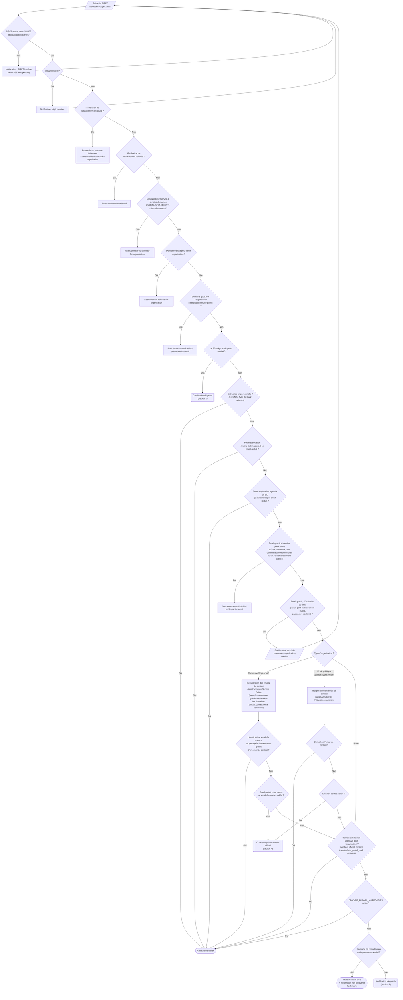
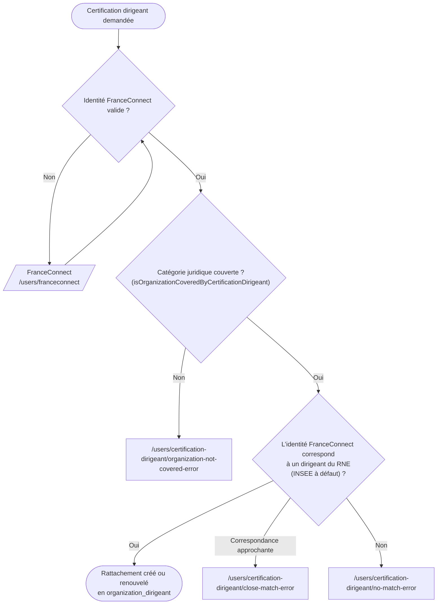
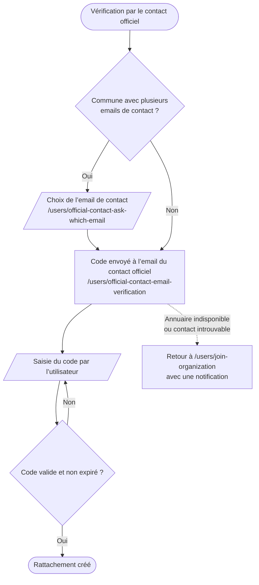
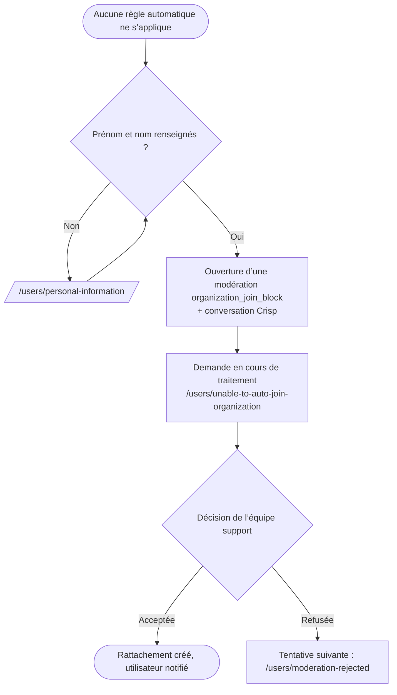

# Sign-in and organization join flow

How a user goes from the "S'identifier avec ProConnect" button to a session for the service provider (SP).
This document replaces the old flowchart ("Demande d'authentification sur bouton ProConnect").

The diagrams follow the code; when they disagree, the code wins:

- authentication and requirement chain: `src/middlewares/navigation-guards/` (`meta.ts`, `guards.ts`, `process.ts`)
- join rules: `joinOrganization` in `src/managers/organization/join.ts`
- error → page mapping: `postJoinOrganizationMiddleware` in `src/controllers/organization.ts`
- organization categories: `src/services/organization.ts` and `packages/identite/src/services/organization/`

## 1. Overview

Every step is a navigation guard: when a requirement is not met, the guard redirects to the page that fixes it, then the chain runs again from the start.

```mermaid
flowchart TD
  start([Le FS envoie l’utilisateur vers ProConnect]) --> email[/"Saisie de l’email<br>/users/start-sign-in"/]
  email --> emailValid{Email valide ?}
  emailValid -- Non --> email
  emailValid -- Oui --> known{"Compte existant<br>avec un mot de passe ?"}
  known -- Oui --> signIn[/"Connexion : mot de passe, lien magique ou clé d’accès<br>/users/sign-in"/]
  known -- Non --> signUp[/"Choix du mot de passe<br>/users/sign-up"/]
  signIn --> verified
  signUp --> verified
  verified{"Email vérifié récemment<br>et navigateur de confiance ?"}
  verified -- Non --> verifyEmail[/"Saisie du code reçu par email<br>/users/verify-email"/] --> verified
  verified -- Oui --> mfa{"2FA exigée par le FS<br>ou imposée à l’utilisateur ?"}
  mfa -- Oui --> doMfa[/"Connexion 2FA ou configuration de la 2FA"/] --> hasOrg
  mfa -- Non --> hasOrg

  hasOrg{"Membre d’une organisation<br>(et de celle du SIRET indiqué par le FS) ?"}
  hasOrg -- Non --> join[["Rejoindre une organisation<br>(section 2)"]]
  join --> hasOrg
  hasOrg -- Oui --> selected{Organisation sélectionnée ?}
  selected -- "Non, plusieurs organisations" --> select[/"Choix de l’organisation<br>/users/select-organization"/] --> orgMfa
  selected -- "Oui, ou une seule organisation" --> orgMfa
  orgMfa{"L’organisation impose la 2FA ?"}
  orgMfa -- Oui --> doMfa2[/"Connexion 2FA ou configuration de la 2FA"/] --> fc
  orgMfa -- Non --> fc
  fc{"Le FS exige une identité FranceConnect<br>(ou l’identité doit être renouvelée) ?"}
  fc -- Oui --> franceConnect[/"FranceConnect<br>/users/franceconnect"/] --> dirigeant
  fc -- Non --> dirigeant
  dirigeant{"Le FS exige un dirigeant certifié ?"}
  dirigeant -- Oui --> certif[["Certification dirigeant<br>(section 3)"]] --> perso
  dirigeant -- Non --> perso
  perso{"Prénom et nom renseignés ?"}
  perso -- Non --> personal[/"/users/personal-information"/] --> done
  perso -- Oui --> done([Session transmise au FS])
```

After a new membership, the user also sees `/users/welcome` and gets the "Votre compte ProConnect a bien été créé" email (no email for certified dirigeants).

## 2. Joining an organization

The user lands on `/users/join-organization`. If the email domain matches organizations already known to ProConnect, and the SP gave no SIRET hint, `/users/organization-suggestions` is shown first.

The rules below run in this order; the first one that matches decides.
"Free email" means a webmail address (gmail.com, orange.fr…), see `usesAFreeEmailProvider`.

When the Annuaire APIs are unavailable or have no contact, the commune or school rules are skipped and the next rules apply.

## 3. Dirigeant certification

Used when the SP requests the dirigeant ACR (`certificationDirigeantRequested`), and to renew an expired certification.

## 4. Official contact code

For communes and public schools, when the user's email is not the one listed in the Annuaire.

## 5. Moderation

From the pending page, the user can cancel the request to change their email, their name or the organization.
The support team decides in a separate back-office, outside this repository.
